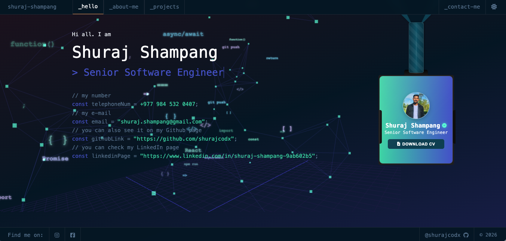

# Multi-Design Developer Portfolio Template (6-in-1 UI Engine)

An open-source, customizable developer portfolio template built with **React 19**, **TypeScript**, **Three.js**, **Framer Motion**, and **Vite** — featuring **6 iconic design paradigms** that visitors can switch between live or developers can lock to their favorite style in a single config file.



## 🎨 6 Live Design Templates (Preview on `surajrai.name.np`)

Switch live between all 6 templates (each supporting **Dark** & **Light** modes) using the on-screen **Template Dock**, keyboard shortcuts (`1`–`6`), or direct URL parameters:

| # | Template | Aesthetic & Signature Details | Live Preview Link |
| :- | :--- | :--- | :--- |
| **1** | **Neumorphism** | Soft extruded matte surfaces, dual ambient shadows, recessed progress troughs, tactile push-buttons | [`?template=neumorphism`](https://surajrai.name.np/?template=neumorphism) |
| **2** | **Claymorphism** | 3D inflated pastel/vivid clay cards, deep inner highlights, floating 3D clay spheres, spring physics | [`?template=claymorphism`](https://surajrai.name.np/?template=claymorphism) |
| **3** | **Neo-Brutalism** | Raw 3px ink borders, hard 6px offset shadows, halftone dot matrix, mechanical hover shifts | [`?template=neobrutalism`](https://surajrai.name.np/?template=neobrutalism) |
| **4** | **Retro Y2K** | Cyber-Millennium OS window chrome (`[_][□][×]`), gradient title bars, CRT scanlines, LED meters | [`?template=y2k`](https://surajrai.name.np/?template=y2k) |
| **5** | **Liquid Glass** | Spatial computing frosted glass, specular 1px rim refraction, floating pill dock, aurora cosmos | [`?template=liquid-glass`](https://surajrai.name.np/?template=liquid-glass) |
| **6** | **Skeuomorphism** | Brushed anodized metal headers, screw rivets, stitched leather trim, glowing recessed VFD readouts | [`?template=skeuomorphism`](https://surajrai.name.np/?template=skeuomorphism) |

---

## ✨ Key Features

- **6 Handcrafted Design Systems × 2 Color Modes (12 Themes)**: Every template adapts typography, surface materiality, shadows, borders, skill bars, code windows, and 3D WebGL colors.
- **Interactive Template Studio & Config Exporter**: Built-in modal allowing visitors and developers to preview templates, copy `src/config/templates.ts` snippets, and share direct template links.
- **Template-Aware 3D WebGL Background**: Dynamic Three.js code sprites, perspective grid, and node constellation that automatically match the active template and pause when off-screen.
- **Zero-Component-Edit Customization**: Update all personal info, skills, projects, experience, and default template inside `src/config/`.

---

## 🚀 Quick Start

```bash
# 1. Clone the repository
git clone https://github.com/shurajcodx/dev-portfolio-template.git
cd dev-portfolio-template

# 2. Install dependencies
pnpm install

# 3. Start the development server
pnpm run dev
```

Visit `http://localhost:5173` and press keys `1`–`6` (or use the bottom Template Dock) to test-drive all 6 templates!

---

## ⚙️ How to Configure Your Portfolio (`src/config/`)

### 1. Choose Your Default Template (`src/config/templates.ts`)

```ts
export const themeConfig: ThemeConfig = {
  defaultTheme: 'dark',           // 'dark' | 'light'
  defaultTemplate: 'liquid-glass', // 'neumorphism' | 'claymorphism' | 'neobrutalism' | 'y2k' | 'liquid-glass' | 'skeuomorphism'
  enableToggle: true,
  enableTemplateSwitcher: true,   // Set to false if you want to lock your site to a single template
};
```

### 2. Personal Information (`src/config/personal.ts`)
- Name, role title, executive bio, location, email, phone, profile photo, and resume PDF.

### 3. Skills (`src/config/skills.ts`)
- Grouped skills by category (`Frontend`, `Backend`, `Database`, `DevOps`, `Tools`) with proficiency levels (`1–100`).

### 4. Projects (`src/config/projects.ts`)
- Project cards with descriptions, tech stacks, categories, live demo URLs, and GitHub links.

### 5. Experience & Education (`src/config/experience.ts`)
- Career timeline and academic background.

---

## 📦 Build & Deploy

```bash
# Type-check and build for production
pnpm run build

# Preview production build locally
pnpm run preview

# Deploy to GitHub Pages
pnpm run deploy
```

## 📄 License

MIT License — free to use, customize, and deploy for your own developer portfolio!
